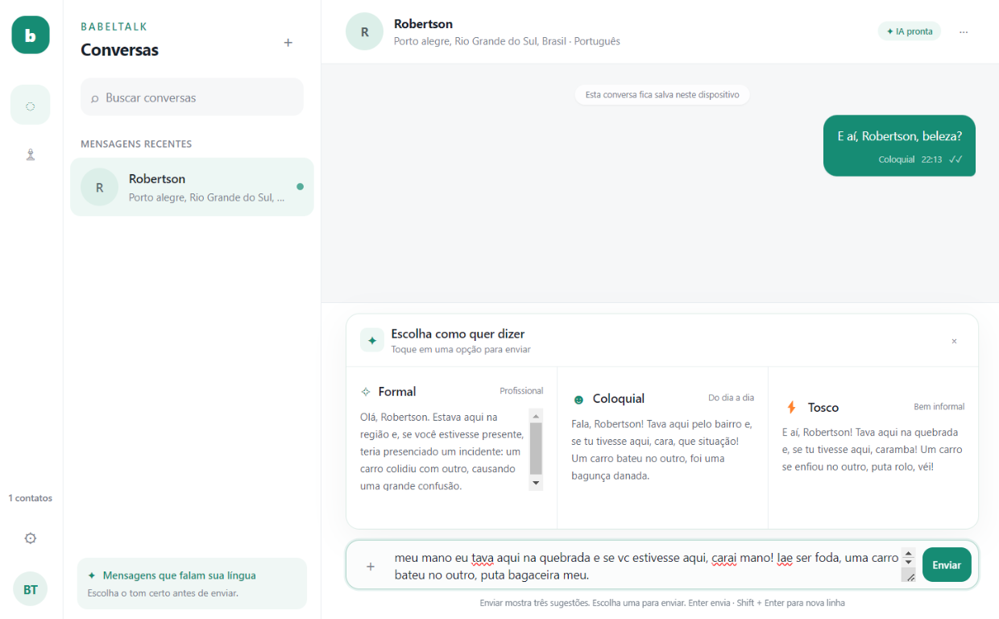
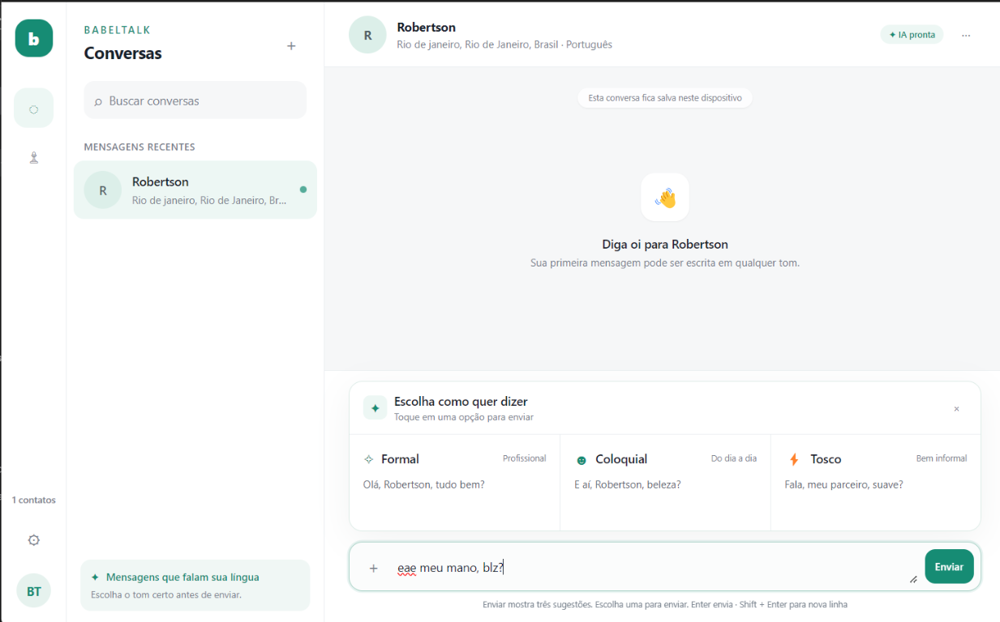
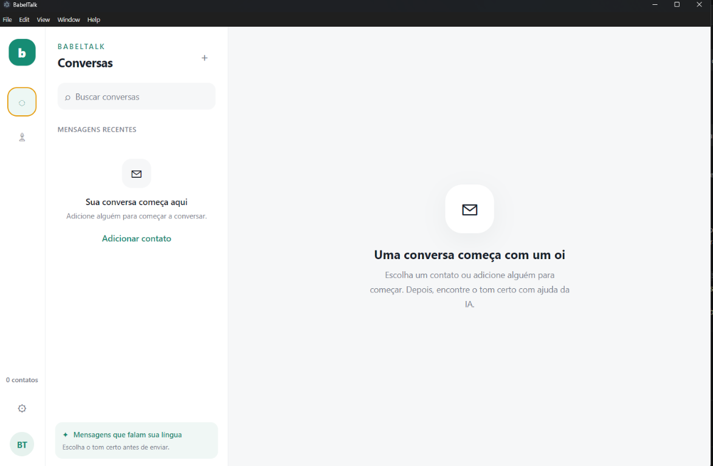

# BabelTalk

Aplicativo desktop de mensagens que ajuda você a escolher o tom certo e conversar entre regiões e idiomas.

[](https://github.com/flaviofdsx/Babeltalk/actions/workflows/build.yml)
[](LICENSE)

## Funcionalidades

- Gere três versões da mensagem antes de enviar: **Formal**, **Coloquial** e **Descontraído**.
- Use OpenRouter com DeepSeek V4 Flash por padrão ou selecione OpenAI nas configurações.
- Adapte expressões regionais considerando o perfil de quem envia e de quem recebe.
- Cadastre contatos com país, estado ou província, cidade, idioma e observações.
- Traduza sugestões para o idioma principal do destinatário.
- Mantenha contatos, perfil e histórico de mensagens localmente no dispositivo.
- Edite e remova contatos e configure o modelo de IA usado pelo app.

## Capturas de tela

### Sugestões com regionalismos



### Escolha do tom antes de enviar



### Tela inicial



## Stack

- Electron
- React e TypeScript
- Vite e TailwindCSS
- Zustand
- SQLite com `better-sqlite3`
- OpenAI SDK
- `electron-builder`

## Pré-requisitos

- Node.js 20.19 ou superior
- npm
- Uma chave de API da OpenAI para gerar sugestões

## Instalação

```bash
git clone https://github.com/flaviofdsx/Babeltalk.git
cd Babeltalk
npm install
```

## Configuração

A chave da API do OpenRouter é **administrada pelo criador do BabelTalk** e nunca é solicitada ao usuário final. As requisições de IA passam por uma camada de proxy administrada com controle de orçamento, limites e cache local para evitar chamadas duplicadas.

Em desenvolvimento, copie `.env.example` para `.env` e preencha a variável `ADMIN_OPENROUTER_API_KEY` (ou configure `ADMIN_LLM_PROXY_URL`). O app só carrega `.env` com `NODE_ENV=development`; em produção o arquivo é ignorado. Nunca adicione chaves reais ao repositório.

## Transporte P2P

O BabelTalk utiliza **WebRTC DataChannel** para comunicação P2P entre dispositivos, com sinalização e descoberta desacopladas. Quando o contato está offline, as mensagens são enfileiradas localmente (outbox) com backoff exponencial e entregues automaticamente quando o canal é restabelecido.

## Arquitetura Multiplataforma

O código de domínio, fila offline (outbox) e contratos de transporte ficam no pacote `shared/`, reutilizável tanto no **Electron** (desktop) quanto no **React Native** (mobile).

## Como rodar em desenvolvimento

```bash
npm run dev
```

## Como gerar build

Compile a aplicação:

```bash
npm run build
```

Para gerar o instalador da plataforma atual:

```bash
npm run dist
```

O workflow também gera instaladores Windows (NSIS), macOS (DMG) e Linux (AppImage) em tags de release `v*`.

## Como contribuir

Leia o [guia de contribuição](CONTRIBUTING.md) antes de abrir uma issue ou pull request.

## Licença

Distribuído sob a licença MIT. Consulte [LICENSE](LICENSE).
